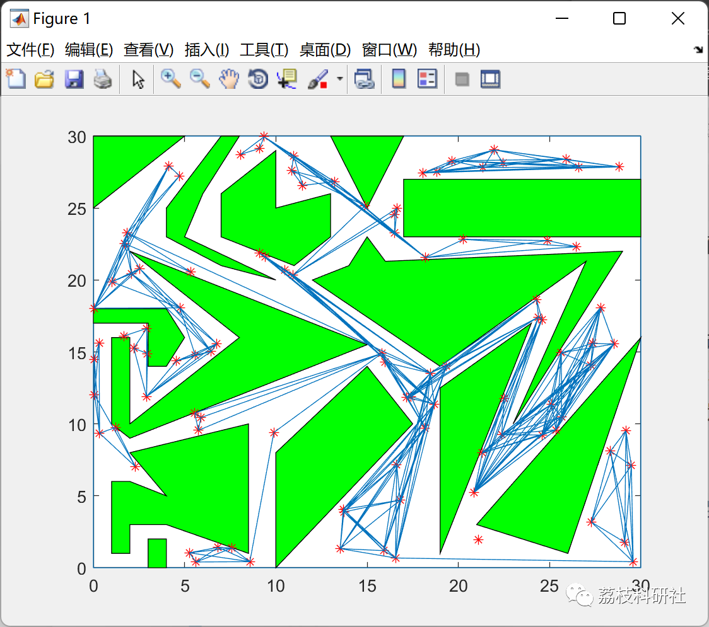
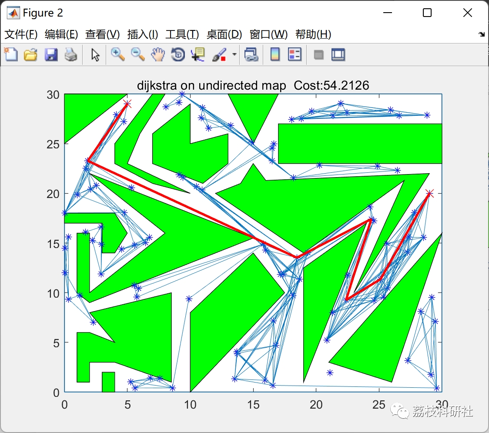
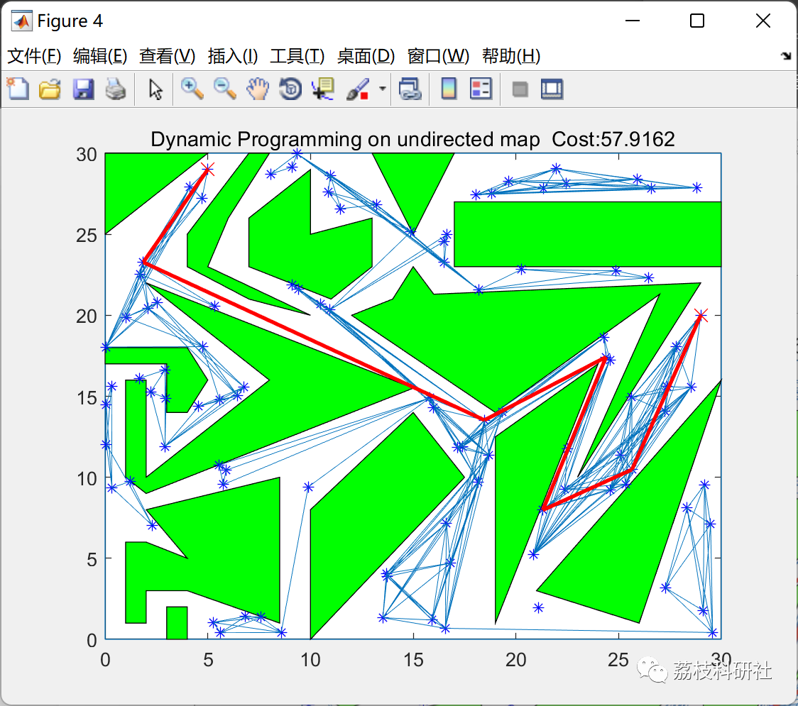

# Path Planning for Mobile Robots Based on Dijkstra, A* and Dynamic Programming (Matlab Code Implementation)

💥💥💥💞💞💞 Welcome to this blog❤️❤️❤️ 💥💥💥
🏆 Bloggers' Advantages: 🌞🌞🌞 The content of the blog strives for rigorous thinking and clear logic to facilitate readers.
⛳️ Mantra: "A journey of a thousand miles begins with a single step."
Litchi Research Society
Code Collection: Power Systems, Intelligent Algorithms and Applications, Neural Network Prediction, Path Planning, Optimized Scheduling, Workshop Scheduling, Image Processing, Signal Processing...
🎁 Special Section Links:
🌈🌈🌈🌟🌟🌟 Electrical Code Drone and Physical Application Path Planning Intelligent Algorithms and Their Applications Optimized Scheduling Neural Network Prediction Workshop Scheduling Image Processing Romantic Her Signal Processing Mathematical Modeling My Thoughts Speech Processing Complete Code Issues
💥1 Overview
In sampling-based methods, we need to generate a certain number of points on the unoccupied areas of the given map. Then, we calculate which nodes connect to which other nodes. Through this approach, we obtain an undirected graph generated from the randomly generated points.
To generate these points, we can use some complex methods to distribute nodes as intelligently as possible around the map. However, in that repository, we chose to generate them uniformly at random. We generated 100 nodes, located in the free areas of the map. With the given mapping, the generated nodes and their connections were created.
We tested path planning for 102 node graphs using Dijkstra, A*, and dynamic programming.
📚2 Run Results
📝2.1 Dijkstra Algorithm
📝2.2 A* Algorithm
📝2.3 Dynamic Programming
🎉3 Matlab Code Implementation
Click the article's lower left corner to read more

## Images

<!-- PAYMENT_BLOCK -->

## Get this dataset

- Payment link (Stripe): [Buy now](https://buy.stripe.com/3cs8yP7sY87d0vu9AB)
- Payment QR code: 

<!-- /PAYMENT_BLOCK -->
